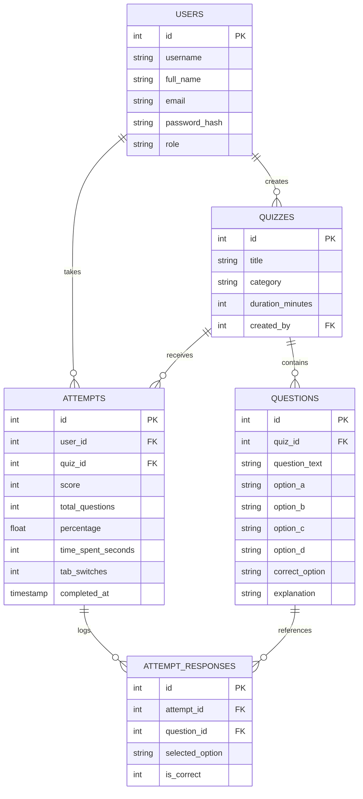

# 🎓 CampusQuiz — College Assessment & Evaluation Web Portal


> A full-stack, responsive College Assessment Portal featuring role-based authentication, real-time timed exams, anti-cheat tab-switch detection, automated grading, detailed scorecards with explanations, and a campus hall of fame leaderboard.

---

## 📌 Problem Statement & Solution

* **The Problem**: Traditional pen-and-paper tests or generic Google Forms lack exam integrity, cannot track tab switches or cheating attempts, require tedious manual grading, and lack instant feedback with question explanations.
* **The Solution**: **CampusQuiz** automates the entire college examination workflow:
  * **Students** take proctored, timed assessments with an interactive question palette and tab-switch warning system.
  * **The System** automatically grades answers in real time and stores every attempt and individual response into a relational SQLite database.
  * **Faculty / Admins** create quizzes, add multiple-choice questions with answer keys, and audit student scores.

---

## 🌟 Key Features

### 1. 🔐 Role-Based Access Control
* **Student Mode**: Take tests, track live progress, view past scorecards, and inspect correct answers with conceptual explanations.
* **Faculty / Admin Mode**: Create quizzes, add multiple-choice questions with answer keys, delete quizzes, and audit all student submission records.
* **Security**: Passwords securely hashed using Werkzeug (`pbkdf2:sha256`) with session-based route protection.

### 2. ⏱️ Interactive Live Exam Room
* **Real-Time Countdown Timer**: Automatically syncs and auto-submits when the time runs out.
* **Interactive Question Palette**: Visual grid indicating answered vs. unanswered questions with quick jump navigation.
* **Clean Card Interface**: One-click radio selection with clear visual feedback.

### 3. 🛡️ Smart Anti-Cheating System
* Uses the browser's `visibilitychange` API to detect whenever a student switches tabs or minimizes the test window.
* Pops up a warning alert on the student's screen.
* Increments and records the total number of tab switches into the database for faculty review.

### 4. 📊 Instant Scorecard & Performance Analytics
* Instant calculation of total score, accuracy percentage, and time taken.
* Detailed review mode showing the student's selected answer vs. the correct answer with clear explanations.

### 5. 🏆 Campus Leaderboard (Hall of Fame)
* Gamified leaderboard ranking students by highest score and fastest completion speed.
* Displays 🥇 Gold, 🥈 Silver, and 🥉 Bronze badges for top performers.

---

## 🗄️ Database Architecture (`quiz.db`)

The database consists of 5 relational tables normalized with foreign key constraints:



---

## 🚀 How to Run Locally

### Option 1: One-Click Launch (Windows)
Double-click the **`run.bat`** file in this folder. It will initialize the database, launch the web server, and open your browser automatically.

### Option 2: Terminal / Command Prompt
```bash
# 1. Navigate to the project directory
cd college_quiz_portal

# 2. Run the application
python app.py
```
Open your browser and navigate to: **`http://127.0.0.1:5000`**

---

## 🔑 Demo Accounts for Testing

| Role | Username | Password | Privileges |
| :--- | :--- | :--- | :--- |
| **Faculty / Admin** | `admin` | `admin123` | Create quizzes, add questions, view all student logs |
| **Student Demo** | `student1` | `student123` | Take quizzes, review scorecards, view leaderboard |

*(You can also use the **"Register here"** button to create a new student or faculty account at any time)*.

---

## 📂 Project Structure

```
college_quiz_portal/
│
├── app.py                # Main Flask application with routes and controllers
├── database.py           # SQLite schema, migrations, and seed data generator
├── quiz.db               # SQLite database file
├── run.bat               # Windows one-click launcher
├── README.md             # Project documentation (this file)
├── .gitignore            # Git ignore file
│
├── templates/            # HTML5 frontend templates
│   ├── base.html         # Base layout with navigation and alerts
│   ├── login.html        # Authentication page with quick demo auto-fill
│   ├── register.html     # Account registration form
│   ├── dashboard.html    # Student dashboard and quiz catalog
│   ├── quiz.html         # Live quiz engine with timer and anti-cheat system
│   ├── result.html       # Scorecard and detailed review with explanations
│   ├── leaderboard.html  # College Hall of Fame leaderboard
│   └── admin.html        # Faculty admin dashboard and question builder
│
└── static/
    └── css/
        └── style.css     # Custom UI styling and active states
```

---

## 🎓 Viva & Presentation Q&A

**Q1: Why choose SQLite over MySQL or MongoDB?**  
*Answer*: SQLite is lightweight, serverless, and self-contained in a single file (`quiz.db`), making it zero-configuration and instantly portable across any machine without needing an external database server.

**Q2: How does the anti-cheat system work?**  
*Answer*: It utilizes the browser's native `document.addEventListener('visibilitychange')`. Whenever the page is hidden (e.g. user switches tabs, opens Google, or minimizes), it triggers an alert and increments a counter passed to the server upon submission.

**Q3: How are student scores and questions stored?**  
*Answer*: Each quiz attempt generates an entry in the `attempts` table. Each individual question answered is saved into `attempt_responses` referencing the question ID and attempt ID, enabling granular scorecard reviews.
